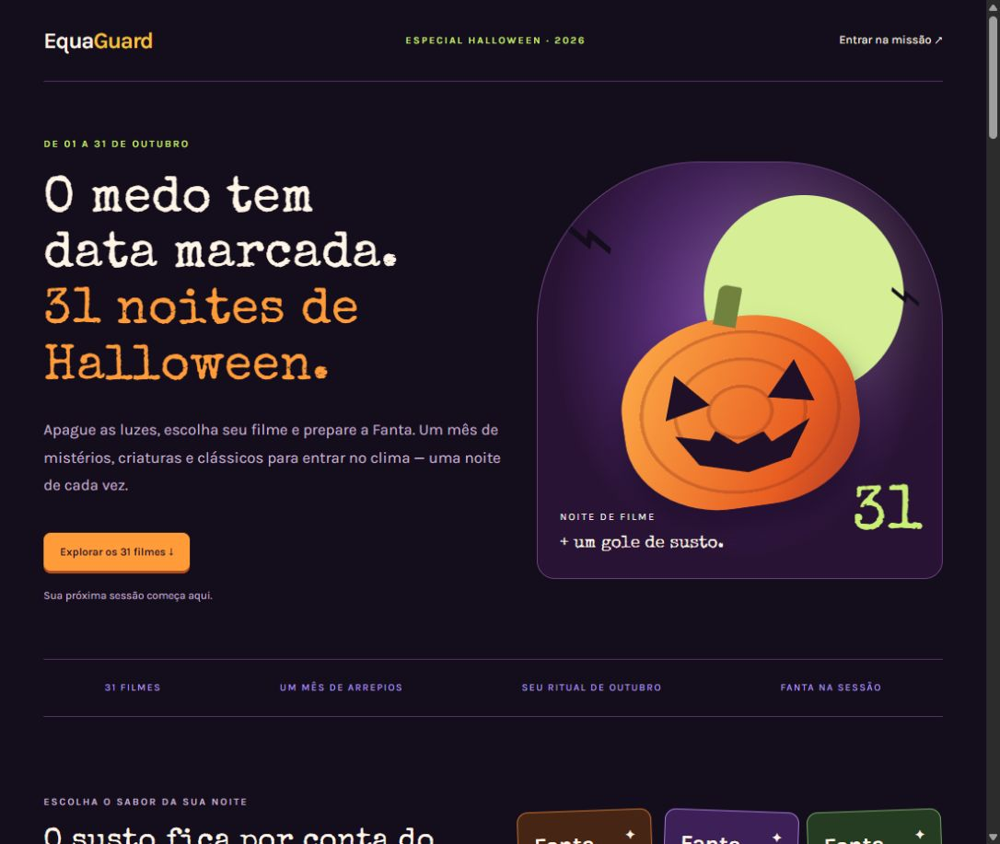
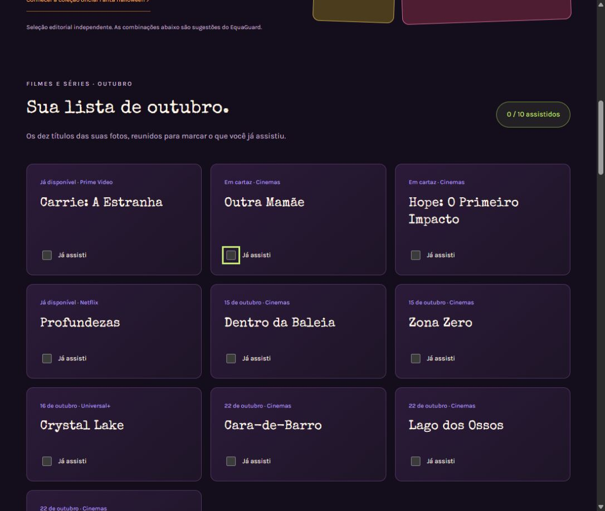
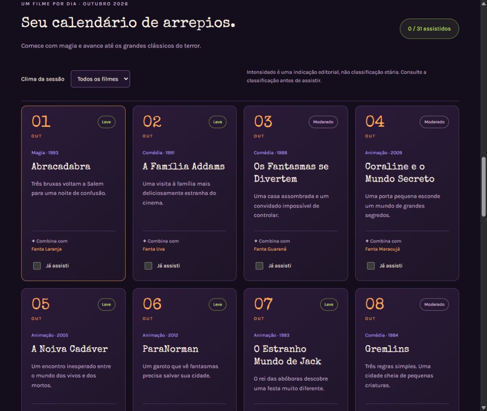
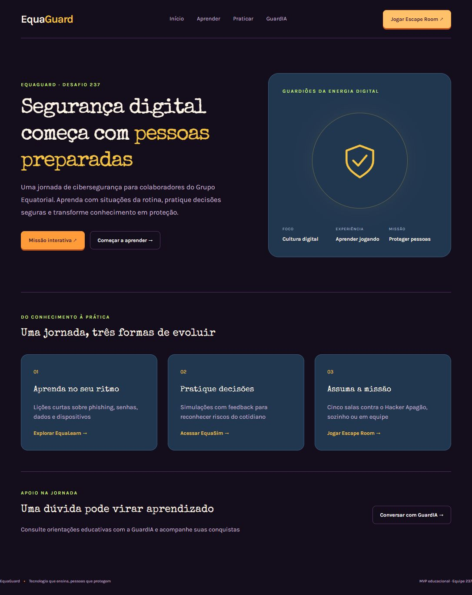
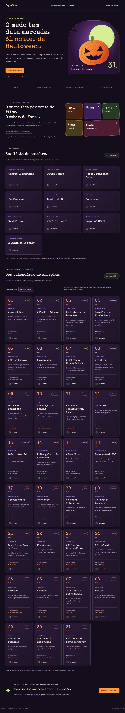

<!-- HALLOWEEN-SCREENSHOTS-START -->
# EquaGuard — Halloween e checklist de outubro

Edição com calendário de 31 filmes, sugestões de Fanta e checklist dos dez filmes e séries das imagens enviadas. As marcações de assistidos ficam salvas no navegador, separadamente em cada lista.

## Como abrir

1. Extraia o ZIP inteiro, mantendo a estrutura de pastas.
2. No Windows, execute `INICIAR_EQUAGUARD.cmd`. É necessário ter Python instalado; o inicializador prepara o ambiente e instala o Flask, com acesso à internet na primeira execução.
3. Aguarde a abertura automática do navegador. O endereço padrão é `http://127.0.0.1:3000/#inicio`; se a porta estiver ocupada, o inicializador informa outra porta.
4. Caso seja solicitado, escolha um perfil fictício de demonstração. Mantenha o servidor aberto enquanto usa o site.

## Telas do site

Capturas reais da versão local, realizadas em 5 de novembro de 2026. As imagens estão na pasta `docs/telas/` e podem ser abertas diretamente após extrair o ZIP.

### Página inicial de Halloween

### Checklist de outubro

Dez títulos das fotos enviadas, com contador e opção “Já assisti”. Datas e plataformas foram transcritas das imagens e podem mudar.

### Calendário de 31 filmes

Um filme por dia, filtro de intensidade e progresso de assistidos. Intensidade editorial não substitui classificação etária.

### Acesso à plataforma EquaGuard

### Página de Halloween completa

A captura abaixo reúne também a seção Fanta e todos os títulos das duas listas.

## Conteúdo do pacote

Código-fonte, recursos visuais, fontes, testes, documentação e capturas de tela. Ambiente virtual, banco de dados local, dados de sessão e arquivos de configuração privados não acompanham o pacote.

<!-- HALLOWEEN-SCREENSHOTS-END -->

---

# EquaGuard

Plataforma educacional de cibersegurança com lições, simulações, recomendações, conquistas e o Escape Room **Guardiões da Energia Digital**. Projeto demonstrativo da equipe 237, adaptado da base Conecta Campus.

## Funcionalidades

- Perfis fictícios de campo, atendimento e administrativo, nos modos colaborador e gestão.
- Diagnóstico inicial, cinco lições interativas e comparação pré/pós.
- Simulações em duas etapas; a primeira escolha determina a situação seguinte. O falso suporte é um desafio avançado.
- GuardIA com FAQ por palavras-chave e recomendações priorizadas pelas dificuldades registradas.
- XP, quatro níveis, sete conquistas, histórico e proteção contra recompensa duplicada.
- Indicadores agregados de participação, conclusão, acertos, reporte, evolução e recomendações.
- Escape Room local para 2 a 6 pessoas, com cinco salas, evidências e protocolo final.

### Regras da missão

A equipe escolhe 20 ou 30 minutos. O cronômetro continua ao atualizar ou trocar de módulo. Uma decisão incorreta desconta 30 segundos; uma dica desconta 60 segundos, uma vez por sala. O servidor valida a ordem, o prazo e as respostas. A primeira vitória concede 250 XP ao perfil que iniciou a partida. Há revisão educativa na vitória e ao esgotar o tempo. Novas tentativas não duplicam XP.

